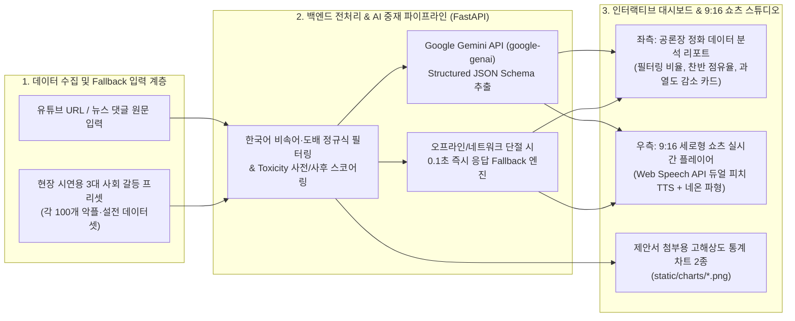

# Implementation Plan: Agora-Shorts (공론장 중재 AI 쇼츠 자동 생성기)

> [!IMPORTANT]
> **공모전 타겟:** 「제1회 동양AI빅데이터융합 아이디어 공모전」 출품 및 현장 포스터 발표 시연용 풀스택 프로토타입
> **핵심 가치:** 온라인 뉴스/유튜브 댓글창의 감정적 욕설·혐오 표현을 실시간 필터링(Detoxification)하고, 찬반 양측의 핵심 논거(Core Arguments)만 추출하여 중립적 아나운서 톤의 40초 양자 대립 토론 쇼츠(9:16)로 자동 렌더링하는 공론장 중재 파이프라인

---

## 1. 시스템 아키텍처 개요 (System Architecture)



---

## 2. 디렉토리 및 파일 구조 (Directory Structure)

```text
/home/antigravity/
├── implementation_plan.md          # 전체 아키텍처 및 구현 계획 문서
├── requirements.txt                # Python 패키지 의존성 명세
├── generate_charts.py              # 제안서(HWP 서식 4) 첨부용 고해상도 차트 2종 생성 스크립트
├── app.py                          # FastAPI 기반 백엔드 서버, 전처리 파이프라인, Gemini API & 프리셋 API
├── presets_data.py                 # 3대 사회 갈등 프리셋 (각 100개 분량 현실적 댓글 원문 + 정밀 분석 JSON)
└── static/
    ├── index.html                  # 미니멀리스트 다크모드 UI (Tailwind CSS + 커스텀 오디오 파형/쇼츠 UI)
    ├── app.js                      # 프론트엔드 상태 관리, 9:16 쇼츠 시뮬레이터, Web Speech API 제어
    └── charts/
        ├── chart1_sentiment_shift.png  # 정화 전/후 감정 과열도 커널 밀도 분포도 (KDE Plot)
        └── chart2_topic_clusters.png   # 찬성 vs 반대 핵심 키워드 군집 빈도 비교 차트
```

---

## 3. 핵심 기능별 상세 설계 (Feature Specifications)

### 기능 A. 입력 및 오프라인 안전장치 (Fallback Preset 3종)
* **자유 입력 지원:** 상단 입력 바에서 유튜브 영상 URL 또는 뉴스 댓글 원문 텍스트 묶음을 입력받아 분석 수행.
* **현장 시연 무결성 보장 프리셋 3종 (`presets_data.py`):**
  1. **프리셋 1 (`preset_1`):** 심야 시간대 배달 오토바이 소음 규제 및 단속 의무화 찬반 설전 (100개 댓글 요약본 + 핵심 논거 6턴)
  2. **프리셋 2 (`preset_2`):** 대학가 원룸촌 전동킥보드 즉시 견인 및 전면 통행 금지 설전 (100개 댓글 요약본 + 핵심 논거 6턴)
  3. **프리셋 3 (`preset_3`):** 70세 이상 고령 운전자 조건부 면허 반납 의무화 설전 (100개 댓글 요약본 + 핵심 논거 6턴)
* **0.1초 즉시 응답 보장:** 프리셋 선택 시(또는 `GEMINI_API_KEY` 미설정/네트워크 오프라인 시) 사전 검증된 고품질 분석 JSON과 실제 100개 댓글 전처리 통계를 즉시 반환하여 현장 발표 중 지연이나 에러를 원천 차단.

### 기능 B. 데이터 전처리 및 Gemini API 구조화 파이프라인 (`app.py`)
* **한국어 댓글 전처리 모듈 (`preprocess_comments`):**
  * 초성 욕설(`ㅅㅂ`, `ㅂㅅ`, `ㅈㄹ` 등), 비속어·혐오 표현 사전 매칭, 특수문자 반복 도배글 필터링.
  * 필터링된 댓글 수(`filtered_curse_count`), 정화 전 감정 과열도(`toxicity_before`), 정화 후 과열도(`toxicity_after`), 논리성 지수 향상폭 계산.
* **Google Gemini API (`google-genai` SDK) 연동:**
  * 환경변수 `GEMINI_API_KEY`가 존재할 경우 `genai.Client()`를 통해 `gemini-2.5-flash` 모델 호출.
  * `response_mime_type="application/json"` 및 엄격한 JSON 스키마(`issue_title`, `raw_stats`, `debate_script` 6턴 배열) 강제.

### 기능 C. 인터랙티브 9:16 쇼츠 플레이어 UI & 분석 대시보드 (`static/index.html`, `static/app.js`)
* **좌측 패널 (데이터 분석 리포트 & 원문 대조):**
  * **핵심 지표 카드 4종:** 총 분석 댓글 수 & 악플 필터링 비율, 정화 전 감정 과열도(Toxicity), 정화 후 논리성 지수(Logic Index), ESG 공론장 건전성 등급.
  * **찬반 여론 점유율 바 차트:** PRO(찬성, Blue) vs CON(반대, Amber/Red) 비율 시각화.
  * **실시간 악플 필터링 로그 & 6턴 핵심 논거 타임라인:** 원본 악플 예시(취소선 및 블러 처리)와 AI가 정제한 논리적 문장 비교, 턴별 클릭 시 해당 턴 즉시 재생 지원.
  * **제안서 첨부용 통계 차트 모달/미리보기 탭:** 생성된 `chart1_sentiment_shift.png`, `chart2_topic_clusters.png`를 웹 UI 내에서도 즉시 확인 및 다운로드 가능.
* **우측 패널 (9:16 세로형 쇼츠 실시간 시뮬레이터):**
  * **9:16 스마트폰 쇼츠 프레임:** 상단 LIVE 배지, 이슈 타이틀 헤더, 40초 카운트다운 프로그레스 바.
  * **듀얼 AI 아바타 스테이지:** 찬성 측(PRO, Cyan/Blue 테마)과 반대 측(CON, Rose/Amber 테마) 아바타 카드 배치. 발화 중인 아바타에 네온 링 글로우 및 실시간 CSS 오디오 파형(Waveform) 애니메이션 활성화.
  * **쇼츠 동적 자막 & 핵심 논거 배지:** 현재 발화자의 `core_point` 태그와 정제된 `text` 대사를 가독성 높은 쇼츠 자막 스타일로 실시간 렌더링.
  * **Web Speech API (`window.speechSynthesis`) 듀얼 피치 보이스:**
    * 찬성(PRO) 아바타: 차분하고 중후한 아나운서 톤 (`pitch: 0.85`, `rate: 1.02`)
    * 반대(CON) 아바타: 또렷하고 날카로운 아나운서 톤 (`pitch: 1.18`, `rate: 1.02`)
    * 6턴(각 약 6.6초, 총 40초) 자동 연속 진행 및 정밀 타이머 동기화.

### 기능 D. 제안서(한글 HWP 서식 4) 첨부용 통계 차트 생성 (`generate_charts.py`)
* `Noto Sans CJK KR` 한글 폰트를 적용하여 깨짐 없는 300 DPI 출판 품질 차트 2종을 `static/charts/`에 자동 생성:
  1. `chart1_sentiment_shift.png`: 원본 악플 데이터의 극단적 감정 과열도 분포(Red)가 AI 중재 파이프라인 통과 후 중립적·논리적 분포(Blue)로 이동하는 커널 밀도 분포도(Kernel Density Plot).
  2. `chart2_topic_clusters.png`: 찬성 측 핵심 키워드 군집(Blue)과 반대 측 핵심 키워드 군집(Red/Coral)의 텍스트 마이닝 빈도 비교 수평 바 & 버블 차트.
